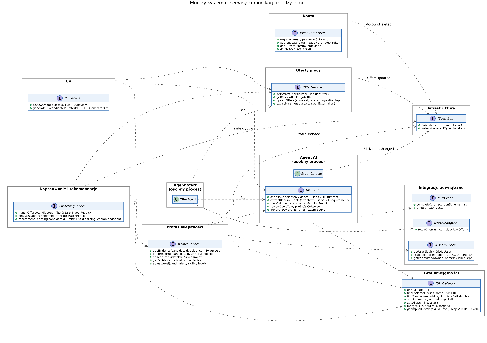
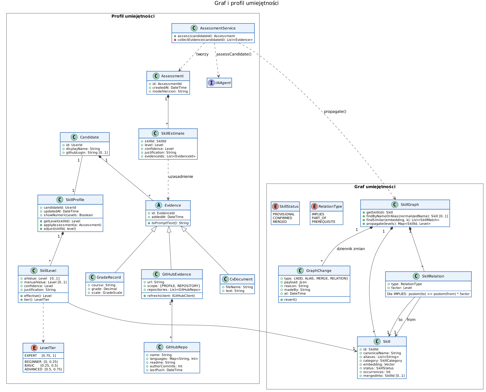
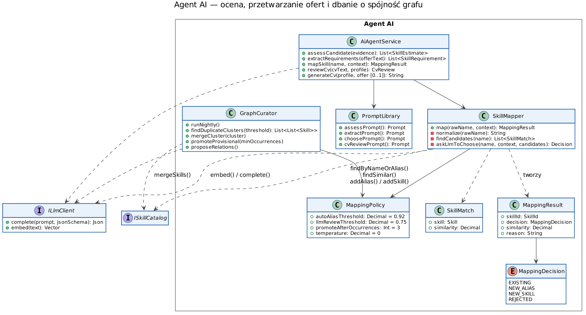
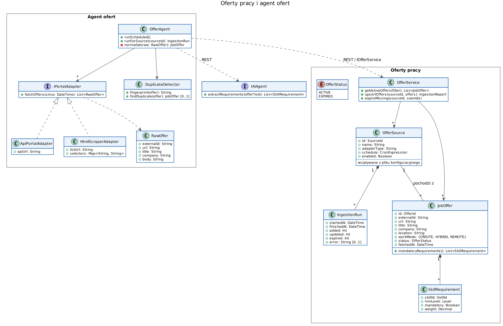
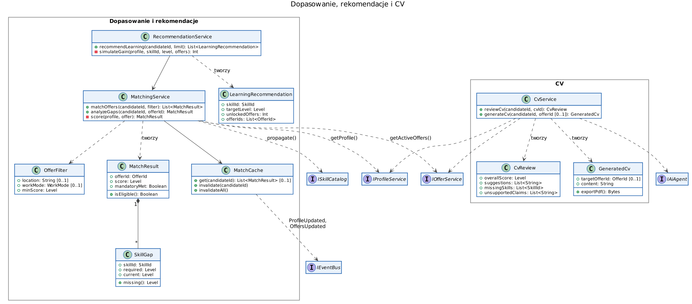

# Diagramy klas — SkillMatrix

System składa się z niezależnych modułów. Moduły nie sięgają do swoich danych bezpośrednio — komunikują się przez interfejsy serwisów (wywołania synchroniczne, a w przypadku agentów — REST) oraz zdarzenia publikowane na szynie zdarzeń (asynchronicznie).

## Moduły i serwisy komunikacji

| Moduł | Udostępnia | Korzysta z | Zdarzenia |
|---|---|---|---|
| Konta | `IAccountService` | — | publikuje `AccountDeleted` |
| Graf umiejętności | `ISkillCatalog` | — | — |
| Profil umiejętności | `IProfileService` | `IAiAgent`, `ISkillCatalog`, `IGitHubClient` | publikuje `ProfileUpdated`; subskrybuje `AccountDeleted` |
| Oferty pracy | `IOfferService` | — | publikuje `OffersUpdated` |
| Agent ofert (osobny proces) | — | `IOfferService` (REST), `IAiAgent` (REST), `IPortalAdapter` | — |
| Agent AI (osobny proces) | `IAiAgent` | `ILlmClient`, `ISkillCatalog` | publikuje `SkillGraphChanged` |
| Dopasowanie i rekomendacje | `IMatchingService` | `IProfileService`, `IOfferService`, `ISkillCatalog` | subskrybuje `ProfileUpdated`, `OffersUpdated`, `SkillGraphChanged` (unieważnia pamięć podręczną) |
| CV | `ICvService` | `IProfileService`, `IOfferService`, `IAiAgent` | — |
| Integracje | `ILlmClient`, `IGitHubClient`, `IPortalAdapter` | model językowy (LLM), GitHub API, portale | — |

Pominięto klasy trywialne (np. `User`, identyfikatory `*Id`, `Level` = liczba z przedziału [0, 1]).

## Graf i profil umiejętności

Graf umiejętności (`SkillGraph`) jest wspólnym językiem całego systemu: tymi samymi węzłami opisany jest profil kandydata i wymagania ofert. Relacja `IMPLIES` pozwala wnioskować o umiejętnościach pokrewnych (np. C++ ≥ 0.8 ⇒ C ≥ 0.6).

`SkillLevel` przechowuje osobno wartość AI (`aiValue`) i ręczną korektę kandydata (`manualValue`); do dopasowania używana jest `effective()` — korekta, jeśli istnieje, w przeciwnym razie wartość AI. `tier()` zamienia poziom na opis (Początkujący … Ekspert) wyświetlany domyślnie.

## Agent AI

Agent AI to jedyne miejsce, które rozmawia z modelem językowym. Pełni rolę administratora grafu: `SkillMapper` decyduje o każdej nowej nazwie, a `GraphCurator` okresowo porządkuje graf.

## Oferty pracy i agent ofert

Agent ofert działa jako osobny proces. Każdy portal obsługuje osobny adapter (`IPortalAdapter`) — dodanie portalu nie wymaga zmian w reszcie systemu. Lista portali i harmonogram są w pliku konfiguracyjnym.

## Dopasowanie, rekomendacje i CV

---

## Spójność grafu umiejętności

**Problem.** Skoro węzły grafu tworzy AI, to ta sama umiejętność może trafić do grafu kilka razy albo w złej postaci:

| Rodzaj niejednoznaczności | Przykład |
|---|---|
| Synonimy i skróty | „JS” / „JavaScript”, „k8s” / „Kubernetes” |
| Pisownia i wersje | „ReactJS” / „React.js” / „React 18” |
| Język | „bazy danych” / „databases” |
| Różna szczegółowość | „React” / „React Hooks” / „frontend” |
| Niedeterminizm modelu | ta sama oferta przetworzona dwa razy daje inne nazwy |
| Halucynacje / nie-umiejętności | „praca w dynamicznym zespole” jako węzeł |

Skutek: kandydat z „JavaScript” nie pasuje do oferty wymagającej „JS”, a dopasowanie i rekomendacje przestają mieć sens.

**Jak zapobiegamy** (realizuje to `SkillMapper` i `GraphCurator`, przypadki UC-23, UC-20, UC-21):

1. **AI nie tworzy węzłów swobodnie — najpierw wybiera z istniejących.** Każda nazwa przechodzi przez mapowanie (UC-23); nowy węzeł to ostateczność.
2. **Normalizacja nazw** przed wyszukiwaniem: małe litery, usunięcie numerów wersji, kropek, spacji i myślników.
3. **Kanoniczna nazwa + aliasy.** Jeden węzeł ma wiele nazw; synonim staje się aliasem, nie nowym węzłem.
4. **Wyszukiwanie po podobieństwie znaczeniowym (embeddingi).** Podobieństwo ≥ 0.92 → automatyczny alias; 0.75–0.92 → LLM wybiera z listy kandydatów (odpowiedź ograniczona schematem JSON do istniejących ID albo „nowa”); < 0.75 → nowy węzeł.
5. **Graf startowy z gotowej klasyfikacji** (np. ESCO lub tagi Stack Overflow), żeby AI od początku miało do czego mapować.
6. **Reguły szczegółowości w promptach:** węzeł = konkretna technologia lub umiejętność, bez wersji; cechy miękkie odrzucane.
7. **Deterministyczne ustawienia modelu** (temperatura 0, stałe prompty, zapisana wersja modelu).
8. **Węzły tymczasowe:** nowy węzeł ma status `PROVISIONAL` i jest zatwierdzany dopiero po wystąpieniu w ≥ 3 ofertach; pojedyncze pomyłki nie wpływają na graf.
9. **Nocne porządkowanie:** `GraphCurator` szuka skupisk bardzo podobnych węzłów i scala je (`MERGED`, `mergedInto`), przepinając profile i oferty.
10. **Dziennik zmian (`GraphChange`)** z uzasadnieniem każdej decyzji — każde scalenie można cofnąć.

Źródła diagramów (PlantUML): [`docs/diagrams/`](../diagrams/). Renderowanie: `make diagrams` w katalogu głównym.
