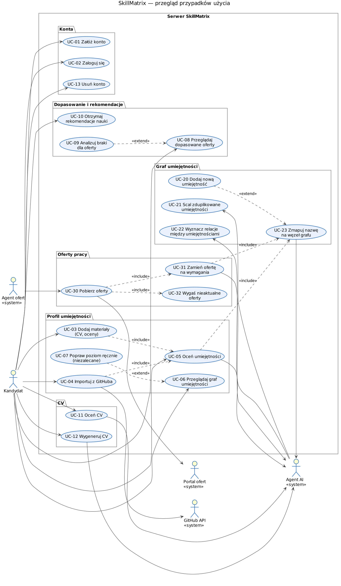
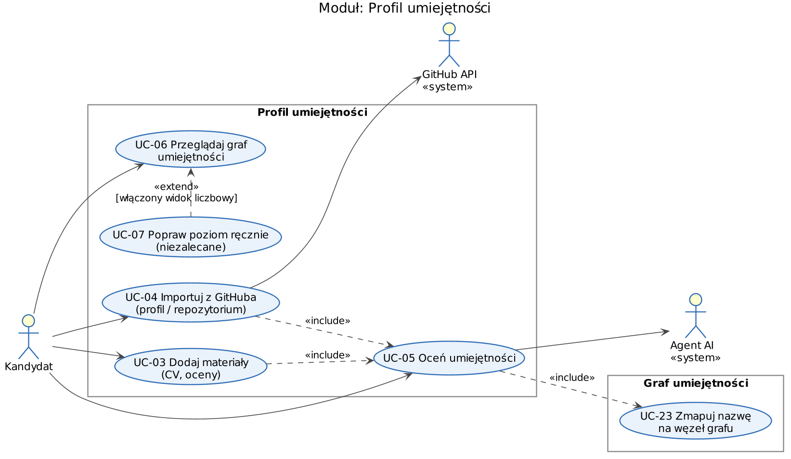
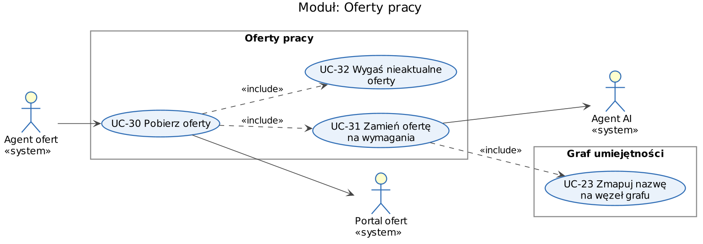
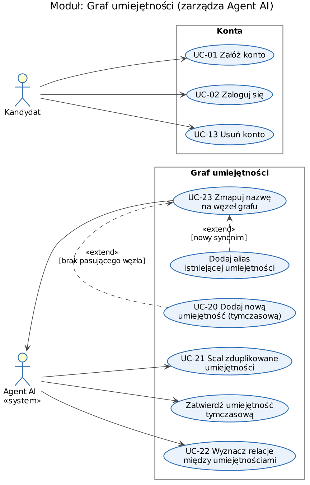
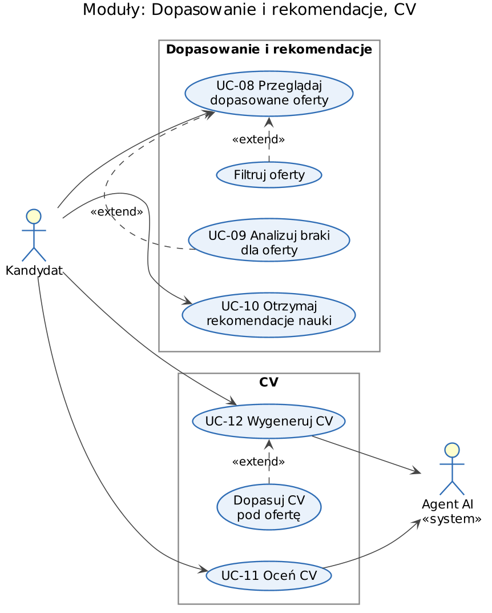

# Przypadki użycia — SkillMatrix

## Aktorzy

Granicą systemu na diagramach jest **serwer SkillMatrix** (konta, profile, oferty, dopasowanie, CV, graf umiejętności). Oba agenty działają jako osobne procesy i komunikują się z serwerem przez API, dlatego występują jako aktorzy.

| Aktor | Rodzaj | Kim / czym jest |
|---|---|---|
| Kandydat | człowiek | Jedyny człowiek w systemie. Dostarcza materiały, przegląda swój graf, oferty, rekomendacje i CV. |
| Agent ofert | program (nasz moduł) | Robot, który według harmonogramu wchodzi na portale z ofertami pracy, pobiera ogłoszenia i przekazuje je do serwera. Sam nie używa AI. |
| Agent AI | program (nasz moduł) | Cała „inteligencja” systemu. Ocenia umiejętności kandydata, zamienia treść ofert na umiejętności z grafu, ocenia i generuje CV. Pełni też rolę administratora grafu: dodaje węzły, scala duplikaty, wyznacza relacje. Do rozumienia tekstu używa zewnętrznego modelu językowego (LLM, np. Claude API). |
| GitHub API | system zewnętrzny | Dane profilu i repozytoriów kandydata. |
| Portal ofert | system zewnętrzny | Strona z ogłoszeniami o pracę (lista portali w pliku konfiguracyjnym). |

W systemie nie ma administratora-człowieka ani rekruterów.

## Przegląd

Pełne historie użytkownika (z powodami biznesowymi) są w [user-stories.md](../user-stories.md).

## Moduł: Profil umiejętności

Kandydat dostarcza materiały (CV, oceny, GitHub); każde dodanie materiału uruchamia ocenę umiejętności przez Agenta AI. Poziomy są domyślnie pokazywane opisowo; po włączeniu niezalecanej opcji kandydat widzi wartości 0–1 i może je ręcznie poprawić.

## Moduł: Oferty pracy

Oferty nie są wprowadzane przez ludzi — pobiera je Agent ofert z portali, a Agent AI zamienia ich treść na wymagania opisane węzłami grafu umiejętności.

## Moduł: Graf umiejętności, Konta

Graf utrzymuje Agent AI. Kluczowy jest UC-23 — każda nazwa umiejętności (z oceny kandydata albo z oferty) przechodzi przez mapowanie na istniejący węzeł, co zapobiega duplikatom (szczegóły: [architektura](../architecture/README.md#spójność-grafu-umiejętności)).

## Moduły: Dopasowanie i rekomendacje, CV

---

## Opisy kluczowych przypadków użycia

Schemat opisu wg A. Cockburna (UML @ Classroom, tab. 3.1).

### UC-05 Oceń umiejętności

| | |
|---|---|
| **Nazwa** | Oceń umiejętności |
| **Krótki opis** | Serwer przekazuje materiały kandydata do Agenta AI i aktualizuje profil o poziomy umiejętności w skali 0–1. |
| **Aktorzy** | Kandydat (główny), Agent AI (pomocniczy) |
| **Wyzwalacz** | Dodanie materiału (UC-03, UC-04) albo żądanie kandydata „oceń ponownie”. |
| **Warunek wstępny** | Kandydat jest zalogowany i ma co najmniej jeden materiał. |
| **Warunek końcowy** | Profil zawiera dla każdej rozpoznanej umiejętności poziom 0–1, pewność i uzasadnienie; publikowane jest zdarzenie `ProfileUpdated`. |
| **Scenariusz główny** | 1. System zbiera wszystkie materiały kandydata (CV, oceny, dane z GitHuba). 2. System wysyła materiały do Agenta AI. 3. Agent AI zwraca listę oszacowań (nazwa, poziom 0–1, pewność, uzasadnienie). 4. Każda nazwa jest mapowana na węzeł grafu (UC-23). 5. System propaguje poziomy wzdłuż relacji IMPLIES (np. C++ → C). 6. System zapisuje ocenę i aktualizuje profil. 7. System pokazuje kandydatowi graf z poziomami opisowymi (Początkujący … Ekspert). |
| **Scenariusze alternatywne** | 6a. Kandydat ręcznie poprawił poziom danej umiejętności: system zapisuje nową wartość AI obok, ale nie nadpisuje korekty. 7a. Kandydat ma włączony widok liczbowy: system pokazuje dodatkowo wartości 0–1. |
| **Sytuacje błędne** | Agent AI / LLM niedostępny lub przekroczony czas odpowiedzi (60 s); odpowiedź w niepoprawnym formacie. |
| **Stan systemu w razie błędu** | Profil pozostaje bez zmian; materiały są zapisane; kandydat dostaje komunikat „spróbuj później”. |

### UC-23 Zmapuj nazwę na węzeł grafu

| | |
|---|---|
| **Nazwa** | Zmapuj nazwę na węzeł grafu |
| **Krótki opis** | Agent AI przypisuje nazwę umiejętności (z oferty lub z oceny kandydata) do istniejącego węzła grafu, a nowy węzeł tworzy tylko wtedy, gdy żaden nie pasuje. |
| **Aktorzy** | Agent AI |
| **Wyzwalacz** | Krok UC-05 lub UC-31 — pojawia się nazwa umiejętności do zapisania. |
| **Warunek wstępny** | Graf zawiera węzły z aliasami i wektorami podobieństwa (embedding). |
| **Warunek końcowy** | Nazwa wskazuje dokładnie jeden węzeł grafu; zmiana grafu (jeśli była) jest zapisana w dzienniku z uzasadnieniem. |
| **Scenariusz główny** | 1. Agent normalizuje nazwę (małe litery, bez wersji, spacji, kropek i myślników). 2. Agent szuka węzła o tej nazwie lub aliasie — znaleziony: koniec, zwraca węzeł. 3. Agent liczy embedding nazwy z kontekstem i pobiera 5 najbardziej podobnych węzłów. 4. Podobieństwo najlepszego ≥ 0.92: agent dodaje nazwę jako alias tego węzła i go zwraca. |
| **Scenariusze alternatywne** | 4a. Podobieństwo 0.75–0.92: agent pyta LLM, czy to ta sama umiejętność, podając kandydatów (wybór tylko z listy albo „nowa”); LLM wybiera węzeł → alias. 4b. Podobieństwo < 0.75 lub LLM odpowiada „nowa”: agent tworzy węzeł ze statusem TYMCZASOWY (UC-20). 4c. LLM uznaje nazwę za nie-umiejętność (np. „komunikatywność w zespole 5 osób”): nazwa jest odrzucana. |
| **Sytuacje błędne** | LLM niedostępny w kroku 4a. |
| **Stan systemu w razie błędu** | Nazwa trafia do kolejki do ponownego przetworzenia; graf bez zmian. |

### UC-30 Pobierz oferty

| | |
|---|---|
| **Nazwa** | Pobierz oferty |
| **Krótki opis** | Agent ofert pobiera ogłoszenia z portalu, Agent AI zamienia je na wymagania z grafu, a moduł ofert je zapisuje. |
| **Aktorzy** | Agent ofert (główny), Portal ofert, Agent AI (pomocniczy) |
| **Wyzwalacz** | Nadejście terminu z harmonogramu źródła (plik konfiguracyjny). |
| **Warunek wstępny** | Źródło ofert jest skonfigurowane i włączone. |
| **Warunek końcowy** | Nowe oferty zapisane, istniejące zaktualizowane, zniknięte oznaczone jako EXPIRED; zapisany przebieg `IngestionRun`; publikowane zdarzenie `OffersUpdated`. |
| **Scenariusz główny** | 1. Agent ofert pobiera listę włączonych źródeł. 2. Dla źródła pobiera ogłoszenia od daty ostatniego przebiegu (adapter API lub scraper). 3. Odrzuca duplikaty (ten sam `externalId` lub ten sam odcisk treści). 4. Dla każdej nowej oferty prosi Agenta AI o wymagania (UC-31, w tym UC-23). 5. Przesyła paczkę ofert do serwera (`upsertOffers`). 6. Przekazuje listę widzianych ofert; serwer wygasza pozostałe (UC-32). 7. Zapisuje raport przebiegu. |
| **Scenariusze alternatywne** | 3a. Oferta istnieje i zmieniła się treść: ponowne wyodrębnienie wymagań i aktualizacja. 4a. Nie rozpoznano żadnego wymagania: oferta zapisana bez wymagań i nie bierze udziału w dopasowaniu. |
| **Sytuacje błędne** | Portal niedostępny lub zmienił strukturę strony; Agent AI niedostępny. |
| **Stan systemu w razie błędu** | Błąd jednego źródła nie przerywa pozostałych; przebieg zapisany z opisem błędu w logu; nie wygasza się ofert z błędnego źródła. |

### UC-04 Importuj z GitHuba

| | |
|---|---|
| **Nazwa** | Importuj z GitHuba |
| **Krótki opis** | Kandydat podaje link do profilu lub repozytorium GitHub, a system pobiera dane o kodzie jako materiał do oceny. |
| **Aktorzy** | Kandydat (główny), GitHub API (pomocniczy) |
| **Wyzwalacz** | Kandydat wkleja link i zatwierdza import. |
| **Warunek wstępny** | Kandydat jest zalogowany. |
| **Warunek końcowy** | Materiał `GitHubEvidence` zapisany w profilu; uruchomiona ocena (UC-05). |
| **Scenariusz główny** | 1. Kandydat podaje link. 2. System rozpoznaje typ linku (profil / repozytorium). 3. System pobiera z GitHub API listę publicznych repozytoriów (bez forków). 4. Dla każdego repozytorium system pobiera języki, README i liczbę commitów autora. 5. System zapisuje materiał. 6. System uruchamia UC-05. |
| **Scenariusze alternatywne** | 2a. Link do pojedynczego repozytorium: krok 3 pobiera tylko to repozytorium. 5a. Ten sam link był już importowany: system aktualizuje istniejący materiał zamiast tworzyć nowy. |
| **Sytuacje błędne** | Niepoprawny link; zasób nie istnieje lub jest prywatny; przekroczony limit zapytań GitHub API. |
| **Stan systemu w razie błędu** | Żaden materiał nie jest zapisywany; profil bez zmian; kandydat dostaje opis błędu. |

### UC-08 Przeglądaj dopasowane oferty

| | |
|---|---|
| **Nazwa** | Przeglądaj dopasowane oferty |
| **Krótki opis** | Kandydat widzi aktywne oferty posortowane wg dopasowania do swojego profilu. |
| **Aktorzy** | Kandydat |
| **Wyzwalacz** | Kandydat otwiera listę ofert. |
| **Warunek wstępny** | Kandydat jest zalogowany i ma oceniony profil. |
| **Warunek końcowy** | Kandydat widzi listę ofert z wynikiem dopasowania; nic się nie zmienia w systemie poza pamięcią podręczną wyników. |
| **Scenariusz główny** | 1. System pobiera profil kandydata (z uwzględnieniem ręcznych korekt). 2. System pobiera aktywne oferty. 3. Dla każdej oferty system liczy wynik: ważona średnia `min(1, poziom / wymagany)` po wymaganiach oraz flagę spełnienia wymagań obowiązkowych. 4. System sortuje oferty malejąco po wyniku. 5. System wyświetla listę (tytuł, firma, wynik %, oznaczenie braków obowiązkowych). |
| **Scenariusze alternatywne** | 1a. Profil nieoceniony: system wyświetla zachętę do dodania materiałów. 3a. Wyniki w pamięci podręcznej są aktualne: system pomija obliczenia. 5a. Kandydat ustawia filtr: system zawęża listę. 5b. Kandydat wybiera ofertę: UC-09 (braki dla oferty). |
| **Sytuacje błędne** | Brak aktywnych ofert. |
| **Stan systemu w razie błędu** | Komunikat „brak ofert”; system bez zmian. |

### UC-10 Otrzymaj rekomendacje nauki

| | |
|---|---|
| **Nazwa** | Otrzymaj rekomendacje nauki |
| **Krótki opis** | System wskazuje umiejętności, których podniesienie do danego poziomu odblokuje najwięcej ofert. |
| **Aktorzy** | Kandydat |
| **Wyzwalacz** | Kandydat otwiera zakładkę „Czego się uczyć”. |
| **Warunek wstępny** | Kandydat ma oceniony profil; istnieją aktywne oferty. |
| **Warunek końcowy** | Kandydat widzi listę rekomendacji (umiejętność, poziom docelowy, liczba odblokowanych ofert). |
| **Scenariusz główny** | 1. System liczy dopasowanie do wszystkich aktywnych ofert (jak UC-08). 2. System wybiera oferty niespełnione, w których brakuje co najwyżej 2 umiejętności. 3. Dla każdej brakującej umiejętności system symuluje podniesienie jej do wymaganego poziomu i liczy, ile ofert przejdzie próg dopasowania. 4. System sortuje umiejętności malejąco po liczbie odblokowanych ofert. 5. System wyświetla 10 najlepszych rekomendacji z listą odblokowanych ofert. |
| **Scenariusze alternatywne** | 1a. Kandydat wskazał ofertę docelową: rekomendacje liczone tylko dla niej. |
| **Sytuacje błędne** | Kandydat spełnia wszystkie oferty lub żadna oferta nie jest „blisko”. |
| **Stan systemu w razie błędu** | Komunikat wyjaśniający brak rekomendacji; system bez zmian. |
